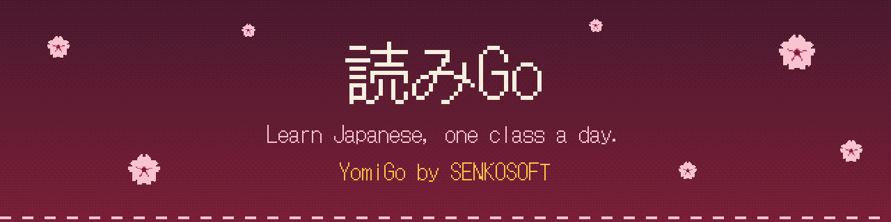
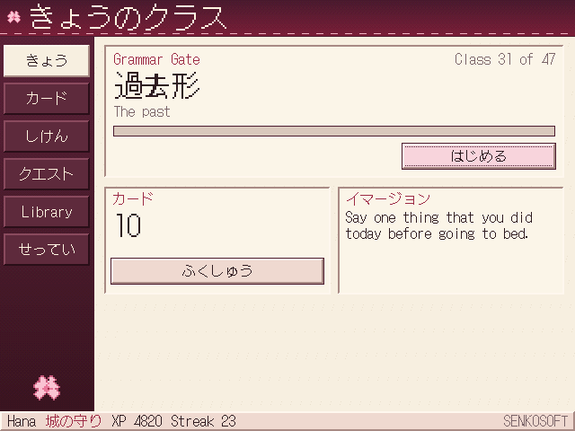
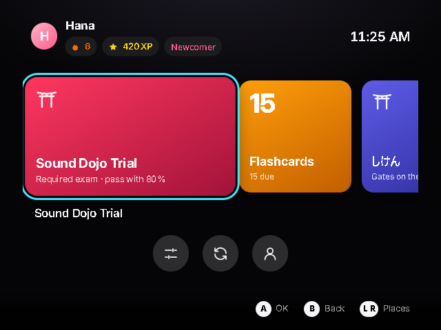
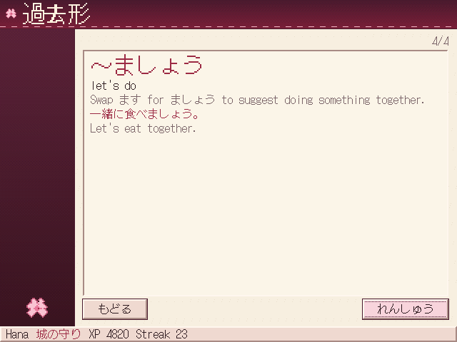
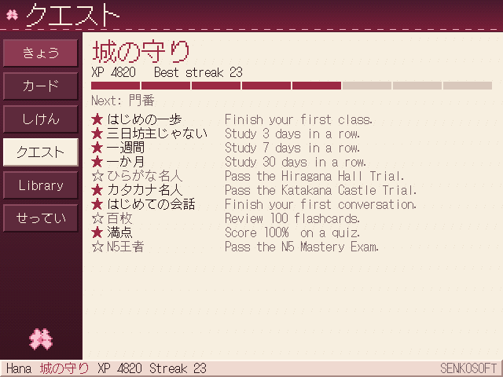
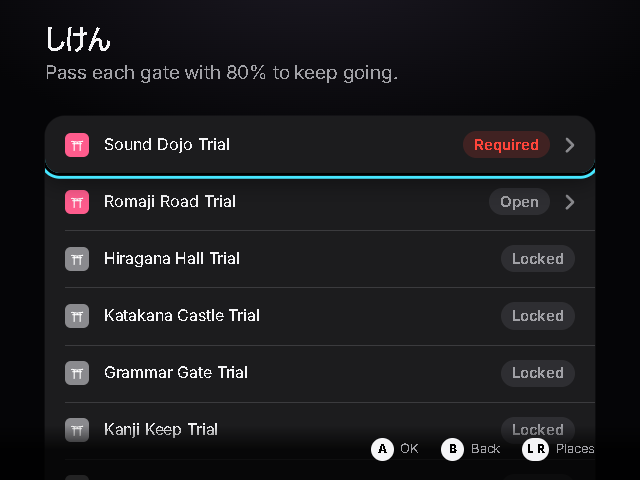
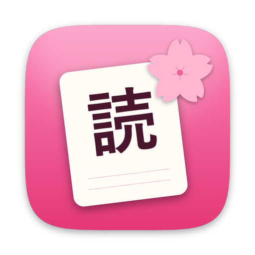

  

  
  

**YomiGo** (読みGo) teaches Japanese from zero. Open it each day, attend a short class, and earn your way up through exams, like levelling up in an RPG. No Japanese needed to start.

  
  

## Get started

**1. Download the version for your device** from the [latest release](https://github.com/knivesbatz/YomiGO/releases/latest):

| Use it on | Download | Open it with |
|---|---|---|
| Windows PC | `YomiGo-Windows.zip` | `YomiGo.exe` |
| TV, with a controller | `YomiGo-Windows.zip` | `YomiGoHTPC.exe` |
| Android phone | `YomiGo.apk` | Tap it to install |
| Chrome or Firefox | `YomiGoReader.zip` | See the [install guide](docs/INSTALL.md#browser-extension) |

**2. Unzip it and open it.** On Windows, there's nothing to install. Windows may warn you about an unknown publisher the first time.

**3. Type your name and take the entrance exam,** or choose to start from day one. YomiGo finds your level and takes it from there.

Need more help? The [install guide](docs/INSTALL.md) has every step.

## What a day looks like

Each class takes a few minutes and has up to ten steps:

1. **Warm-up:** go over what you learned before.
2. **Lesson:** meet new sounds, words, or grammar.
3. **Typing:** type each new word a few times, so your fingers learn it too.
4. **Drill:** practise until it sticks. Anything you miss comes back. Stuck? Press **I don't know**.
5. **Conversation:** talk to a character using what you just learned.
6. **Reading:** read a short story, then answer questions on it.
7. **Listening:** hear words and sentences, type what you hear, then repeat lines out loud. This needs a Japanese voice on your device.
8. **Quiz:** score 80% to pass.
9. **Homework:** do a small task, then answer a quick check.
10. **Immersion:** use Japanese in everyday life, with a simple task.

Finish every stage's boss exam to move on. Along the way you earn XP, ranks, streaks, and achievements. Choose 1, 2, or 3 classes a day.

  
  
  

## What you'll learn

You start with sounds and romaji, then learn to read and speak step by step:

**Sounds → Romaji → Hiragana → Katakana → Grammar → Kanji → Real-life Japanese → N5 Exam → Casual speech, opinions, plans, and polite Japanese → N4 Exam**

There's also typing practice, stroke order, counting, polite speech, gestures, and manners. The built-in Study Guide shows you how to set up, and how to study each day. As you learn to read, YomiGo's own menus slowly switch into Japanese.

Studying with Genki? Turn on **Genki practice** to review by textbook lesson.

## Where it's up to

YomiGo is in its early days. The course currently runs from zero to **N4**, the second of the five levels of the Japanese-Language Proficiency Test (JLPT). YomiGo's exams are its own, not official JLPT tests.

| Works now | Coming later |
|---|---|
| 70 classes, 8 exams, flashcards, and graded reading | N3 through N1, and beyond |
| Scripted conversations | AI conversation partners |
| A dictionary of about 22,000 common words | Larger dictionaries |
| Your own flashcards, from the dictionary or the browser | Vertical manga text, and direct game hooking |
| A Text Reader for screenshots, photos, and game text | |
| Listening, dictation, and shadowing | Transcription of your own audio |
| Updates that ask first | Automatic sync between devices |

Some things haven't been tried on real hardware yet, including controllers, CRT TVs, Windows 95, and Android phones. See [what's been tested](docs/COMPATIBILITY.md) and [known issues](docs/KNOWN_ISSUES.md), or the full [roadmap](docs/ROADMAP.md).

## More

- [Install guide](docs/INSTALL.md)
- [Everyday immersion tips](docs/IMMERSION_GUIDE.md)
- [How to build it, and how to help](CONTRIBUTING.md)
- [Report a problem](https://github.com/knivesbatz/YomiGO/issues/new/choose)
- [Credits and licences](NOTICE.md)

 Made by <strong>SENKOSOFT</strong>

